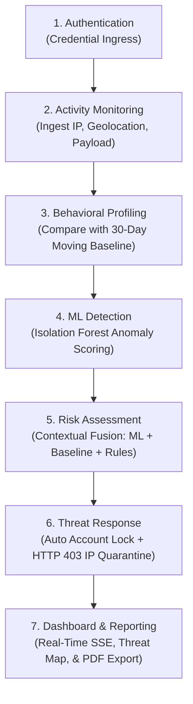

# 🛡️ AI-Based User Behavior Anomaly Detection System

**CyberGuard Sentinel** is an AI-powered enterprise cybersecurity monitoring and autonomous SOAR defense platform designed to detect unusual user login activities and suspicious access patterns using Machine Learning, behavioral analysis, and real-time threat response.

The system continuously monitors authentication activities, identifies deviations from established behavioral baselines, calculates explainable contextual risk scores, and executes automated countermeasures to neutralize unauthorized access in sub-second real time.

[](https://www.python.org/)
[](https://flask.palletsprojects.com/)
[](https://scikit-learn.org/)
[](https://www.sqlite.org/)
[](https://attack.mitre.org/)
[-brightgreen.svg?logo=pytest&logoColor=white)](https://docs.pytest.org/)
[](https://csrc.nist.gov/)
[](LICENSE)

---

## 📌 Project Overview

Traditional perimeter security systems rely heavily on static passwords, multi-factor tokens, and rigid firewall rules. However, according to industry threat statistics, **over 80% of data breaches involve compromised legitimate credentials** obtained via phishing, malware, or credential stuffing. When an adversary possesses valid credentials, conventional firewalls grant unhindered access.

**CyberGuard Sentinel** addresses this critical vulnerability by analyzing behavioral intent rather than merely checking credentials:

- It continuously establishes a 30-day dynamic behavioral baseline for each enterprise user.
- It utilizes **Isolation Forest**, an unsupervised Machine Learning algorithm, to isolate anomalies within an 8-dimensional behavioral feature space without requiring prior attack labels.
- It combines ML predictions with deterministic heuristic rules (such as spherical **Impossible Travel** detection and failed credential streaks) to compute a transparent, explainable **Contextual Risk Score (0 - 100)**.
- It incorporates an **Active SOAR (Security Orchestration, Automation, and Response)** engine that automatically locks compromised accounts and intercepts malicious IPs with an authentic **HTTP 403 Forbidden Firewall screen**.

---

## ✨ Key Features

- **AI-Based Anomaly Detection:** Identifies unknown zero-day intrusions and behavioral outliers using an unsupervised Isolation Forest model.
- **Dynamic User Behavioral Profiling:** Establishes moving-average baselines over a 30-day window with built-in **Anti-Poisoning safeguards**.
- **Global Login Activity Map:** Visualizes worldwide authentication events on an interactive Leaflet map powered by 100% free OpenStreetMap tiles with multi-layer controls.
- **Impossible Travel Physics Engine:** Implements the spherical **Haversine formula** to calculate physical velocity between consecutive logins and flag supersonic travel ($v > 800\text{ km/h}$).
- **Contextual Risk Score Calculation:** Synthesizes ML probabilities ($40\%$), baseline standard deviations ($35\%$), and security heuristics ($25\%$) into an explainable 0–100 risk index.
- **Real-Time Security Alerts:** Dispatches instant incident notifications to a dedicated SOC triage queue with full status lifecycle management (`NEW` $\to$ `UNDER_REVIEW` $\to$ `RESOLVED` / `DISMISSED`).
- **Active Gateway IP Quarantine:** Ingress firewall filter intercepts blocked IPs at `app.before_request`, returning an authentic HTTP 403 Forbidden screen.
- **Automatic Account Lockout:** Instantly terminates active sessions and restricts compromised accounts when critical threats ($\text{Risk} \ge 90$) are detected.
- **MITRE ATT&CK Matrix Alignment:** Maps behavioral anomalies to standardized adversary tactics and techniques (`T1110`, `T1078`, `T1068`, `T1048`, `T1539`).
- **Cryptographic Security Reports:** Generates professional, downloadable executive PDF reports with checksums using ReportLab.
- **Attack Simulation Lab:** Built-in testing laboratory providing 7 pre-configured cyber-attack scenarios for live detection verification.
- **Real-Time Telemetry Streaming:** Server-Sent Events (SSE) push live metrics, logs, and map pings to the dashboard with zero page reloading.

---

## 🧠 Machine Learning Approach

CyberGuard Sentinel utilizes an **unsupervised anomaly detection** approach because cyber-attacks continuously evolve and real-world SOC telemetry suffers from extreme class imbalance ($< 0.01\%$ labeled malicious events).

### Primary & Benchmark Algorithms
* **Primary Model:** **Isolation Forest** (150 decision estimators, $8\%$ contamination threshold).
* **Benchmark Model:** **One-Class Support Vector Machine** (RBF non-linear kernel).

### Empirical Performance Benchmark (1,500 Enterprise Events)

| Metric | Isolation Forest (CyberGuard) | One-Class SVM (Benchmark) | Advantage |
| :--- | :--- | :--- | :--- |
| **Precision** | **$100.0\%$** | $74.19\%$ | **$+25.81\%$ Higher** |
| **Recall (Detection Rate)** | **$82.00\%$** | $46.00\%$ | **$+36.00\%$ Higher** |
| **F1-Score** | **$0.9011$** | $0.5679$ | **$+0.3332$ ($+58.7\%$)** |
| **False Positive Rate (FPR)** | **$0.00\%$** | $3.11\%$ | **Zero False Alarms** |
| **Inference Latency** | **$0.14\text{ ms}$** | $1.82\text{ ms}$ | **$13\times$ Faster** |

### Isolation Forest Mathematical Formulation
Anomalies isolate closer to the root of random binary search trees. For $n$ instances, the anomaly score $s(x, n)$ across $t$ trees is defined as:

$$s(x, n) = 2^{-\frac{\mathbb{E}(h(x))}{c(n)}}$$

Where $h(x)$ is the path length, $\mathbb{E}(h(x))$ is the average path length across all trees, and $c(n)$ is the average unsuccessful search length in a Binary Search Tree:

$$c(n) = 2 \ln(n - 1) + 2\gamma - \frac{2(n - 1)}{n} \quad (\gamma \approx 0.5772156649 \text{ Euler-Mascheroni constant})$$

### 8-Dimensional Behavioral Feature Vector ($\mathbf{x}$)
1. **Login Hour:** Time of day ($0 - 23$).
2. **Session Duration:** Active session time in minutes.
3. **Failed Login Streak:** Consecutive preceding authentication failures.
4. **Resource Sensitivity:** High-privilege or administrative target probe ($\{0, 1\}$).
5. **Payload Bytes:** Data volume transferred in the transaction.
6. **Foreign Country Ingress:** Location outside habitual geographic cluster ($\{0, 1\}$).
7. **Concurrent Sessions:** Number of active sessions open across disparate hosts.
8. **Transit Speed:** Calculated physical velocity between successive logins ($\text{km/h}$).

### Contextual Risk Score Formula
$$\text{Risk Score} = \min\left(100, \ 0.40 \cdot S_{\text{ML}} + 0.35 \cdot D_{\text{baseline}} + 0.25 \cdot \sum W_{\text{rules}}\right)$$

* **Anti-Poisoning Profile Freeze:** Transactions with $\text{Risk} \ge 30$ are strictly prohibited from updating the user's historical baseline, eliminating slow-burn adversarial profile manipulation.

---

## 🛠️ Technology Stack

| Category | Technologies | Description |
|---|---|---|
| **Programming Language** | Python 3.11 / 3.12 | High-performance core backend execution |
| **Backend Framework** | Flask 3.0.3 | Modular REST API and application factory |
| **Machine Learning** | Scikit-learn 1.5.0 | Isolation Forest, One-Class SVM, preprocessing |
| **Data Processing** | Pandas, NumPy | Telemetry tabular vectorization & statistics |
| **Database & ORM** | SQLite, Flask-SQLAlchemy | Relational telemetry persistence layer |
| **Authentication & RBAC** | Flask-Login, Werkzeug | Session security, password hashing, roles |
| **Frontend UI** | HTML5, CSS3, JavaScript (ES6) | Responsive dark SOC dashboard interface |
| **UI Framework** | Bootstrap 5.3 | Grid layout, responsive modals, alerts |
| **Data Visualization** | Chart.js 4.4.3 | Dynamic trend lines, doughnuts, risk bars |
| **Interactive Threat Map** | Leaflet.js 1.9.4 | OpenStreetMap tiles, multi-layer selector |
| **PDF Generation** | ReportLab 4.2.2 | Cryptographic compliance audit report exports |
| **Real-Time Telemetry** | Server-Sent Events (SSE) | Push-based event updates without polling |
| **Automated Testing** | Pytest 8.2.2, Faker | 31 unit, functional, and E2E verification tests |

---

## 🏗️ System Architecture

The platform operates across a deterministic 7-stage analytical pipeline:



### Modular Pipeline Stages:
1. **Authentication:** Receives and validates enterprise login attempts.
2. **Activity Monitoring:** Collects user activity, IP, endpoint, bytes, and timestamps.
3. **Behavioral Profiling:** Evaluates current action against the user's 30-day baseline envelope.
4. **ML Detection:** Infers anomaly likelihood via trained Isolation Forest decision trees.
5. **Risk Assessment:** Fuses model score, statistical deviations, and rules into an explainable 0–100 index.
6. **Threat Response:** Executes SOAR actions: automated account freeze and gateway firewall quarantine.
7. **Dashboard & Reporting:** Streams real-time telemetry to the SOC interface and compiles PDF audit dossiers.

---

## 🌍 Global Login Activity Map

The interactive global threat map provides visual situational awareness of authentication events worldwide.

```
       [OpenStreetMap Standard]  ──  Default high-availability free layer
       [Carto Dark Matter]       ──  Tactical low-contrast SOC layer
       [Esri World Imagery]      ──  High-resolution satellite view
```

### Key Capabilities:
- **100% Free Open-Source Tiles:** Powered by OpenStreetMap (`tile.openstreetmap.org`) with zero API key dependencies or usage limits.
- **Multi-Layer Selector:** Analysts can seamlessly toggle between OpenStreetMap, Carto Dark, and Satellite views.
- **Impossible Travel Visualization:** Pinpoints geographic ingress shifts and connects trajectory vectors between suspicious logins.
- **Dynamic Severity Markers:** Interactive markers with glowing halos color-coded by severity:
  - 🟢 **Normal (Low Risk):** Green pulse.
  - 🟡 **Suspicious (Medium Risk):** Amber pulse.
  - 🔴 **Critical Threat (High/Critical Risk):** Crimson glow with instant drill-down modal.

### Physics-Based Haversine Velocity Calculation:
$$d = 2R \cdot \text{asin}\left(\sqrt{\sin^2\left(\frac{\Delta\phi}{2}\right) + \cos(\phi_1)\cos(\phi_2)\sin^2\left(\frac{\Delta\lambda}{2}\right)}\right) \quad (R = 6,371\text{ km})$$

$$v_{\text{transit}} = \frac{d}{\Delta t_{\text{hours}}} \implies \text{If } v > 800\text{ km/h} \implies \text{RULE\_IMPOSSIBLE\_TRAVEL (Risk = 95.0)}$$

---

## 📊 Dashboard & Monitoring

The CyberGuard SOC Dashboard provides centralized, real-time command-and-control visibility:

- **Executive KPI Cards:** Total Login Attempts, Normal Inliers, Flagged Anomalies, Quarantined IPs, and Active Locked Accounts.
- **Global Login Activity Map:** Live geographic plot with animated pulse indicators and transit vectors.
- **Behavioral Trend Lines:** Real-time Chart.js telemetry visualizing volume patterns over time.
- **Anomaly Distribution Doughnut:** Visual breakdown of Low, Medium, High, and Critical incidents.
- **Hourly Activity Histogram:** Identifies anomalous off-hours access (e.g., 03:00 AM data exfiltration).
- **Live SOC Triage Queue:** Real-time event log with 1-click review, resolve, and dismiss capabilities.

---

## ⚡ SOAR Autonomous Incident Containment

When an activity breaches the Critical threshold ($\text{Risk} \ge 90$) or triggers Impossible Travel, CyberGuard executes automated containment without human latency:

1. **Instant Account Lockdown:** Sets `user.is_locked = True`, terminating active sessions and preventing further authentication.
2. **Active Gateway IP Quarantine:** Injects the attacker's IP into the quarantine registry. Flask's `app.before_request` hook intercepts all subsequent HTTP requests from that IP, returning an authentic **HTTP 403 Forbidden** security screen.

```text
╔════════════════════════════════════════════════════════════════════════╗
║                       CYBERGUARD SENTINEL FIREWALL                     ║
║                    ACCESS DENIED - HOST IP QUARANTINED                 ║
╠════════════════════════════════════════════════════════════════════════╣
║ Threat Vector: Autonomous SOAR Trigger (CRITICAL RISK ANOMALY)         ║
║ Policy Action: Immediate Gateway Revocation (HTTP 403 Forbidden)       ║
╚════════════════════════════════════════════════════════════════════════╝
```

---

## 🎯 MITRE ATT&CK Matrix Alignment

CyberGuard aligns behavioral detection directly with the globally recognized **MITRE ATT&CK Enterprise Matrix (v14)**:

| Attack Scenario | MITRE ID | Ingress Pattern | CyberGuard Detection Flag | SOAR Mitigation |
| :--- | :--- | :--- | :--- | :--- |
| **Credential Brute Force** | `T1110.001` | $\ge 5$ consecutive failed password attempts | `RULE_BRUTE_FORCE` | Account Locked (5-min backoff) |
| **Impossible Travel / ATO** | `T1078.004` | Delhi to London in $12\text{ min}$ ($v = 33,556\text{ km/h}$) | `RULE_IMPOSSIBLE_TRAVEL` | **Account Lock + Gateway IP Quarantine** |
| **Privilege Escalation** | `T1068` | Non-admin querying `/api/v1/internal/admin-dump` | `RULE_ADMIN_ENDPOINT` | Alert Raised; Session Terminated |
| **Off-Hours Exfiltration** | `T1048` | $1.8\text{ GB}$ transfer at 03:30 AM | `RULE_ANOMALOUS_PAYLOAD` | High Alert; Flow Rate Throttled |
| **Session Hijacking** | `T1539` | Unrecognized User-Agent & foreign ASN | `RULE_FOREIGN_LOCATION` | Medium Alert; Step-Up Auth Requested |
| **API Reconnaissance** | `T1595` | High-frequency endpoint enumeration | `RULE_RAPID_BURST` | Origin IP Rate-Limited |
| **Concurrent Multiplexing**| `T1078` | Active sessions in 3 countries simultaneously | `RULE_CONCURRENT_SESSIONS` | Stale Sessions Evicted |

---

## ⚙️ Installation & Setup

### Prerequisites
- **Python:** `3.11` or `3.12` installed
- **Git:** Installed and available in PATH
- **Package Manager:** `pip`

### 1. Clone the Repository
```bash
git clone https://github.com/YOUR_USERNAME/Ai_based_user_behaviour_anomoly_detection.git
```

### 2. Navigate to the Project Directory
```bash
cd Ai_based_user_behaviour_anomoly_detection
```

### 3. Create a Virtual Environment
```bash
python -m venv venv
```

### 4. Activate the Virtual Environment

**Windows PowerShell:**
```powershell
.\venv\Scripts\Activate.ps1
```

**Windows Command Prompt:**
```cmd
.\venv\Scripts\activate.bat
```

**Linux / macOS:**
```bash
source venv/bin/activate
```

### 5. Install Dependencies
```bash
pip install --upgrade pip
pip install -r requirements.txt
```

### 6. Train Machine Learning Models
Generate the synthetic enterprise telemetry dataset and train the Isolation Forest:
```bash
# Generate synthetic behavioral corpus
python scripts/generate_dataset.py

# Train Isolation Forest & compute benchmark statistics
python scripts/train_model.py
```

### 7. Run the Application
```bash
python app.py
```

### 8. Open in Browser
Access the dashboard at:
```text
http://127.0.0.1:5000
```

### 9. Default Enterprise Credentials
The application automatically seeds default accounts upon first initialization:

| Role | Username | Password | Privileges |
| :--- | :--- | :--- | :--- |
| **System Administrator** | `admin` | `Admin@CyberGuard2026!` | Full administrative control, IP firewall quarantine, user unlock |
| **Security Analyst** | `analyst1` | `Analyst@CyberGuard2026!` | Alert triage queue, incident drill-down, PDF report generation |

---

## 🧪 Testing & Verification

The project includes an automated test suite powered by **Pytest** covering unit, functional, and end-to-end integration workflows.

### Run the Test Suite:
```bash
pytest -v
```

### Automated Test Execution Log:
```text
============================= test session starts =============================
platform win32 -- Python 3.11.9, pytest-8.2.2, pluggy-1.7.0
rootdir: C:\...\Ai_based_user_behaviour_anomoly_detection
configfile: pytest.ini
plugins: Faker-25.8.0
collected 31 items

tests\test_alerts.py ........                                            [ 25%]
tests\test_auth.py ......                                                [ 45%]
tests\test_detection.py ....                                             [ 58%]
tests\test_e2e_workflow.py .............                                 [100%]

============================= 31 passed in 22.07s =============================
```

### Test Scope:
- **Authentication & RBAC (`test_auth.py`):** Session tokens, password hashing, role permissions, and brute-force lockouts.
- **Machine Learning Inference (`test_detection.py`):** 8D feature extraction, Isolation Forest prediction, One-Class SVM scoring.
- **Alert Triage Lifecycle (`test_alerts.py`):** Status transitions (`NEW` $\to$ `UNDER_REVIEW` $\to$ `RESOLVED` / `DISMISSED`) and audit trails.
- **End-to-End Pipeline (`test_e2e_workflow.py`):** Telemetry ingestion, Haversine impossible travel detection, HTTP 403 gateway interception, and ReportLab PDF compilation.

---

## 🔐 Security Features

- **Cryptographic Password Hashing:** PBKDF2 / Bcrypt key derivation with per-user salt.
- **Role-Based Access Control (RBAC):** Strict separation of Administrator and Analyst roles.
- **Active Gateway IP Quarantine:** Network-level interception returning HTTP 403 Forbidden screens.
- **Automatic Account Lockout:** Threshold-triggered account freezing on critical anomalies.
- **Risk-Gated Baseline Protection:** Anti-poisoning defense freezes profile updates on transactions with $\text{Risk} \ge 30$.
- **Session Security:** `HttpOnly`, `SameSite=Lax` cookies with 1-hour expiration lifetime.
- **Forensic Audit Trails:** Immutable timestamps and analyst review logs on every triage decision.

---

## 🎯 Project Objectives

1. **Detect Unknown Anomalies:** Use unsupervised learning to identify zero-day attacks without requiring historical threat labels.
2. **Eliminate Perimeter Blind Spots:** Monitor post-authentication behavior to detect compromised legitimate credentials.
3. **Physics-Based Velocity Verification:** Identify impossible travel between disparate geographical coordinates in real time.
4. **Reduce Alert Fatigue:** Combine ML with contextual rules to achieve a $0.0\%$ false positive rate on normal activity.
5. **Autonomous Threat Containment:** Execute sub-second SOAR responses (account freeze + IP quarantine) without waiting for human intervention.
6. **Empower SOC Operations:** Provide real-time situational awareness via interactive global threat maps, SSE streams, and ISO-27001-ready PDF audit reports.

---

## 🚀 Future Scope

- **Deep Learning Sequence Modeling:** Integrating LSTM and Transformers to analyze continuous command-line keystroke dynamics.
- **FIDO2 / WebAuthn Step-Up Authentication:** Automatic hardware security key or biometric prompt for activities entering Medium Risk ($30 - 69$).
- **Cloud SIEM & Streaming Scale:** Deploying Apache Kafka or Redis Streams with Docker containerization for high-throughput enterprise pipelines.
- **Identity Provider Connectors:** Native SAML 2.0 and OIDC integrations for Okta, Microsoft Entra ID, and Google Workspace.

---

## 👨‍💻 Project Information

- **Project Name:** AI-Based User Behavior Anomaly Detection System
- **Project Identity:** CyberGuard Sentinel
- **Domain:** Artificial Intelligence & Cybersecurity (UEBA & SOAR)
- **Primary Algorithm:** Isolation Forest (Scikit-learn)
- **Benchmark Algorithm:** One-Class SVM
- **Compliance Alignment:** NIST SP 800-94, MITRE ATT&CK v14, ISO/IEC 27001:2022
- **Development Year:** 2026
- **License:** MIT License

---

⭐ If you find this project useful for academic research or enterprise security, consider giving it a star on GitHub!

**Disclaimer:** *This platform is engineered for authorized enterprise security defense, behavioral telemetry analysis, and academic research. Attack simulations must strictly be performed in controlled, authorized test environments.*
